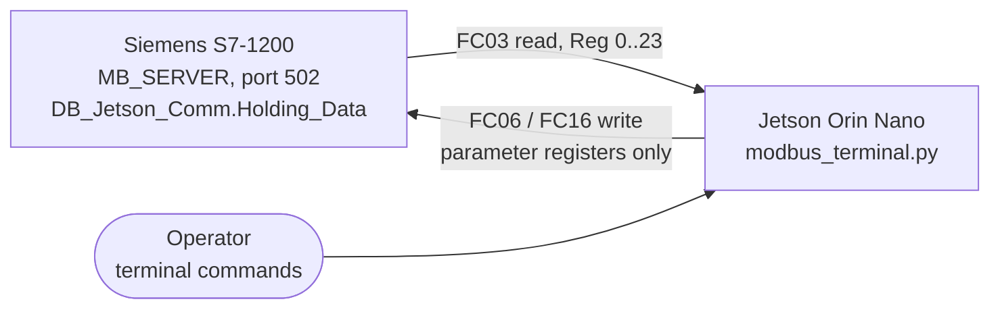

# Pelican Crossing – Modbus TCP Monitor & Control Terminal

Python tools that run on an **NVIDIA Jetson Orin Nano** (or any PC) to **monitor and control** a
Siemens **S7-1200** pelican-crossing PLC over **Modbus TCP**.

> PLC program (SCL, TIA Portal):
> [bahiijrahadi269-sudo/pelican_crossing_walk](https://github.com/bahiijrahadi269-sudo/pelican_crossing_walk)



## What it does

| Script | Purpose |
|---|---|
| `modbus_monitor.py` | **Read-only** monitor. Polls holding registers 0–23 every second, decodes them, logs state and configuration changes, and raises alarms. |
| `modbus_terminal.py` | **Read + write** terminal. Same monitoring, plus typed commands that change PLC parameters. Reuses the read/decode/alarm logic of `modbus_monitor.py`. |

The PLC accepts **only one Modbus client at a time**, so run one of the two scripts, not both.

### Alarms

Each alarm is printed once when it becomes active and once when it clears.

| Level | Alarm | Condition |
|---|---|---|
| CRIT | `OUTPUT_CONFLICT` | Conflicting lights, e.g. vehicle green/amber together with pedestrian green |
| CRIT | `HEARTBEAT_STALE` | Heartbeat (Reg 22) unchanged for more than 3 s: PLC program stopped or stuck |
| WARN | `OUTPUT_MISMATCH` | Output bitmask (Reg 20) does not match the active state |
| WARN | `STATE_INVALID` | State outside 0..6 |
| WARN | `STATE_OVERTIME` | Time in state exceeds its configured duration + 2 s while running |
| WARN | `VIOLATION_SUM` | Reg 1 ≠ Reg 14 + Reg 15 |
| WARN | `CMD_NOT_CLEARED` | One-shot command (Reg 12 / 23) not cleared by the PLC within 1.5 s |
| WARN | `CONFIG_RANGE` | Configuration value out of its valid range |
| WARN | `PAUSE_LONG` / `PARADE_LONG` | Pause or parade lock active longer than a set number of minutes |

### Write safety

- Only parameter / command registers can be written: **2–13, 16–19, 23**. Status registers are rejected.
- Every value is range-checked before it is sent.
- Risky commands (pause, parade lock, state jump, violation reset, raw write) need the operator to type
  `ya` within 20 s.
- After every write the register is **read back**; the command only counts as successful if the PLC
  value actually changed (for the one-shot registers 12 and 23: once the PLC has cleared them).

## Terminal commands

| Command | Effect | Register |
|---|---|---|
| `read` / `read <reg>` | Read all registers (JSON) or one register | – |
| `status on\|off` | Toggle the periodic status line | – |
| `timer <1-6> <s>` | Duration of one state (1–3600 s) | 2–7 |
| `timers <s1> … <s6>` | All six durations at once | 2–7 |
| `buzzer on\|off` | Crossing buzzer | 8 |
| `mode hijau\|kedip` | Standby: steady green / flashing amber | 9 |
| `parade on\|off` | Parade lock *(confirm)* | 10 |
| `run` / `pause` | Run or pause the state machine *(pause: confirm)* | 11 |
| `lompat <0-6>` | Manual state jump *(confirm)* | 12 |
| `sorot auto\|on\|off` | Floodlight mode | 13 |
| `jadwal HH:MM HH:MM` | Floodlight on / off schedule | 16–19 |
| `reset` | Reset violation counters *(confirm)* | 23 |
| `write <reg> <value> […]` | Raw write to allowed registers *(confirm)* | – |
| `help` / `quit` | Help / close the connection cleanly | – |

## Usage

Requires Python 3.8+ and `pymodbus` (the only non-standard dependency; both new `device_id` and
older `slave` / `unit` APIs are supported).

```bash
pip install -r requirements.txt

# Read-only monitor
python3 modbus_monitor.py --plc-ip <PLC_IP>

# One-shot read, print all values as JSON and exit
python3 modbus_monitor.py --plc-ip <PLC_IP> --once

# Read + write terminal
python3 modbus_terminal.py --plc-ip <PLC_IP>
```

| Option | Default | Meaning |
|---|---|---|
| `--plc-ip` | `192.168.8.15` | PLC IP address |
| `--plc-port` | `502` | Modbus TCP port |
| `--slave-id` | `1` | Unit / slave ID |
| `--interval` | `1.0` | Polling interval in seconds (keep well below the PLC's 10 s watchdog) |
| `--pause-alarm-min` | `10` | Minutes of pause before `PAUSE_LONG` |
| `--lock-alarm-min` | `60` | Minutes of parade lock before `PARADE_LONG` |

## Compatibility

Written for the PLC register map of program **v0.7 / v0.7.1** (registers 0–23). Later PLC versions
(v0.8.x) keep the same layout and only add registers 24–25, which these scripts do not read yet.

If the scripts stop polling, the PLC's own watchdog takes over: after 10 s it drops the connection,
and after 60 s it releases pause / parade lock and runs autonomously.

## Author

**Bahiij Rahadi**, D4 Mechatronics, Politeknik Caltex Riau
